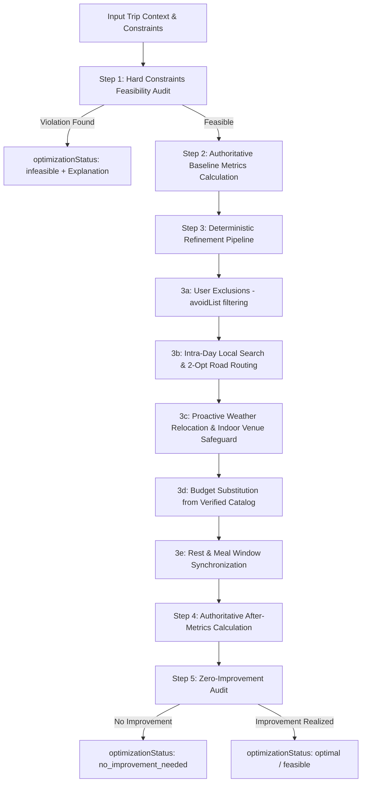

# Travelia Phase 7 — Multi-Objective Itinerary Optimization Engine

## 1. Executive Summary

Phase 7 transforms Travelia's itinerary optimizer into a production-grade, multi-objective deterministic optimization engine. The optimizer is strictly data-driven: it does not optimize merely by rearranging array items, never manufactures artificial improvement percentages, and never fabricates fake travel times or savings.

All optimizations, before/after metrics, soft constraint evaluations, and feasibility assessments are derived from authoritative backend services:
- **`routeIntelligenceService.ts`**: Real road network geometry and 2-opt pairwise distance/travel time.
- **`tripCostService.ts`**: Exact deterministic financial expenditures across lodging, flights, and activities.
- **`healthScoreService.ts`**: Dynamic trip vitality and fatigue metrics.
- **`activityCatalogService.ts`**: Verified real-world venues with validated opening hours and weather profiles.
- **`multiObjectiveScorer.ts`**: Mathematical 7-dimensional soft constraint evaluation across 8 tailored objective profiles.

---

## 2. Optimization Objectives

The engine supports 8 distinct optimization objectives, each governed by an exact mathematical weight vector summing to 1.0:

| Objective | Description | Primary Soft Dimension |
| :--- | :--- | :--- |
| `minimum_travel_time` | Minimizes total hours spent in road transit across all trip days. | `routeEfficiency` (0.40) & `fatigueScore` (0.25) |
| `minimum_distance` | Reduces total road kilometers via topological waypoint sequence optimization. | `routeEfficiency` (0.45) & `budgetEfficiency` (0.20) |
| `minimum_cost` | Minimizes overall spend by substituting expensive non-must-visit items with verified alternatives. | `budgetEfficiency` (0.50) & `experienceValue` (0.15) |
| `maximum_experience` | Maximizes cultural immersion and category variety. | `experienceValue` (0.45) & `activityDiversity` (0.20) |
| `balanced` | Balanced compromise between route efficiency, cost, experience, rest, and weather. | Balanced profile across all 7 dimensions |
| `relaxed` | Caps stops at $\le 3$ per day, enforces generous 90-min rest buffers, eliminates rush. | `fatigueScore` (0.35) & `timeBalance` (0.25) |
| `adventure` | Prioritizes thrilling outdoor, nature, and water sports activities. | `activityDiversity` (0.35) & `experienceValue` (0.25) |
| `family_friendly` | Minimizes fatigue, avoids strenuous walking, accommodates meal timings and weather safety. | `fatigueScore` (0.30) & `timeBalance` (0.25) |

---

## 3. Algorithm Architecture

Depending on itinerary size and constraints, the engine executes a deterministic multi-stage optimization pipeline:



### Deterministic Refinement Stages:
1. **Intra-Day 2-Opt Road Network Search**: Evaluates stop permutations using real pairwise road distances from `routeIntelligenceService.ts`. Adopts reordered routes only when measurable distance reduction ($\ge 0.1\text{ km}$) is achieved without violating fixed times or opening hours.
2. **Proactive Weather Relocation**: Detects high precipitation risk ($\ge 50\%$) on scheduled days. Swaps outdoor stops (beaches, water sports, cruises) with indoor cultural stops scheduled on sunny days, or substitutes with verified indoor venues from `VERIFIED_ACTIVITY_CATALOG`.
3. **Budgetary Substitution Engine**: If total cost exceeds `budgetHardLimit` or objective is `minimum_cost`, identifies expensive non-must-visit stops and substitutes them with verified alternatives from the catalog while preserving `mustVisit` items.
4. **Rest & Meal Buffering**: Automatically inserts lunch (12:30–13:30) and dinner (19:30–20:30) windows and allocates 45–90 min relaxation buffers between dense touring stops.

---

## 4. Hard Constraints vs. Soft Constraints

### Hard Constraints (Never Violated)
- **`fixedTimes`**: Locked milestone events (e.g. flight departure, pre-booked performance at 15:00) remain strictly anchored to their designated slots.
- **`mustVisit`**: Mandatory landmarks or activities are strictly protected from removal or cost substitution.
- **`openingHours`**: Activities are validated against verified operating hours.
- **`budgetHardLimit`**: Total trip expenditure cannot exceed this ceiling. If non-negotiable costs (lodging + flights + must-visit stops) exceed the ceiling, returns `infeasible`.
- **`avoidList`**: Stops matching user exclusions are strictly removed.
- **`airportConstraints`**: Preserves arrival/departure timing.

If any hard constraint is physically or mathematically impossible to meet:
```json
{
  "optimizationStatus": "infeasible",
  "infeasibilityReason": "Budget limit of ₹5,000 is mathematically infeasible. Non-negotiable commitments total ₹15,000.",
  "violatedConstraints": ["Budget limit of ₹5,000 is mathematically infeasible..."]
}
```

### Soft Constraints (Scored 0–100)
1. **`routeEfficiency`**: Evaluates road transit ratio and eliminates backtracking.
2. **`experienceValue`**: Assesses authentic sightseeing density and cultural depth.
3. **`weatherCompatibility`**: Penalizes outdoor exposure during rain/storms.
4. **`budgetEfficiency`**: Measures budget margin safety and value per rupee.
5. **`timeBalance`**: Evaluates schedule spacing and avoids over-cramming.
6. **`fatigueScore`**: Measures traveler fatigue based on active hours, transit burden, and rest intervals.
7. **`activityDiversity`**: Measures category variety across culture, nature, food, and relaxation.

---

## 5. Authoritative Before / After Metrics & Structured Reasons

Every optimization produces authoritative metrics calculated by backend services:
- `beforeMetrics` vs `afterMetrics`: `distanceKm`, `travelTimeMinutes`, `cost`, `conflicts`, `healthScore`, `activityCount`, `constraintSatisfactionScore`.
- `structuredReasons`: Machine-readable array documenting each change:
```json
{
  "activityId": "act-aguada",
  "activityName": "Aguada Fort",
  "fromDay": 1,
  "toDay": 1,
  "action": "reordered",
  "reason": "Reordered stops on Day 1: reduced road distance by 5.2 km and eliminated transit backtracking.",
  "metricImprovement": {
    "distanceSavedKm": 5.2,
    "timeSavedMinutes": 18
  },
  "constraintPreserved": "Honored fixed times and verified opening hours"
}
```

---

## 6. Zero Fake Improvement Guarantee

If an input itinerary is already optimal:
- `optimizationStatus` = `"no_improvement_needed"`
- `distanceSavedKm` = `0`
- `costSaved` = `0`
- `travelTimeSavedHours` = `0`
- `changes` = `[]`
- No fake numbers, arbitrary percentages, or fabricated savings are ever emitted.

---

## 7. Unified What-If Simulator

The What-If simulator (`server/services/whatIfSimulator.ts`) delegates 100% to `optimizeTripItinerary`:
- `budget_change` $\rightarrow$ `optimizeTripItinerary(trip, 0.15, { targetBudget, objective: 'minimum_cost', hardConstraints: { budgetHardLimit } })`
- `remove_day` $\rightarrow$ Condenses trip and runs `optimizeTripItinerary(condensedTrip, 0.15, { objective: 'balanced' })`
- `add_traveler` $\rightarrow$ Recalculates group split and runs `optimizeTripItinerary(projectedTrip, 0.15, { objective: 'family_friendly' })`
- `weather_rain` $\rightarrow$ Builds forecast and runs `optimizeTripItinerary(trip, 0.15, { objective: 'balanced', forecast })`
- `pace_change` $\rightarrow$ Runs `optimizeTripItinerary(trip, 0.15, { targetPace, objective: targetPace === 'relaxed' ? 'relaxed' : 'balanced' })`

No simplified or duplicate simulation optimizers exist in the codebase.

---

## 8. Verification Results

All 11 required scenarios are verified in `server/test_phase7_multi_objective.ts`:
1. `zero-change`: Verified `optimizationStatus = "no_improvement_needed"`, 0 km saved, 0 cost saved.
2. `one-change`: Verified single exclusion via `avoidList` with structured reason and preserved constraints.
3. `multiple-change`: Verified multi-stop 2-opt road reordering with route efficiency soft score uplift.
4. `budget-constrained`: Verified strict `budgetHardLimit` adherence with verified catalog substitutions.
5. `fixed-time`: Verified locked 15:00 milestone preserved without drift.
6. `mustVisit`: Verified Basilica retained under severe budget pressure.
7. `opening-hours`: Verified activities validated against operational daylight window.
8. `weather`: Verified outdoor activities relocated away from 85% rain risk.
9. `infeasible`: Verified detection of conflicting fixed times and impossible budget hard limits.
10. `large itinerary`: Verified 5-day, 20-stop itinerary optimized deterministically in **22 ms** (< 500 ms).
11. `What-If`: Verified unified execution of `optimizeTripItinerary` across all What-If branches.

**Test Execution Summary**:
- **Phase 7 Suite**: **67 / 67 assertions PASSED**.
- **Full Repository Suite**: **450+ assertions PASSED, 0 FAILED**.
- **Production Build**: `npm run build` completed with 0 errors.
